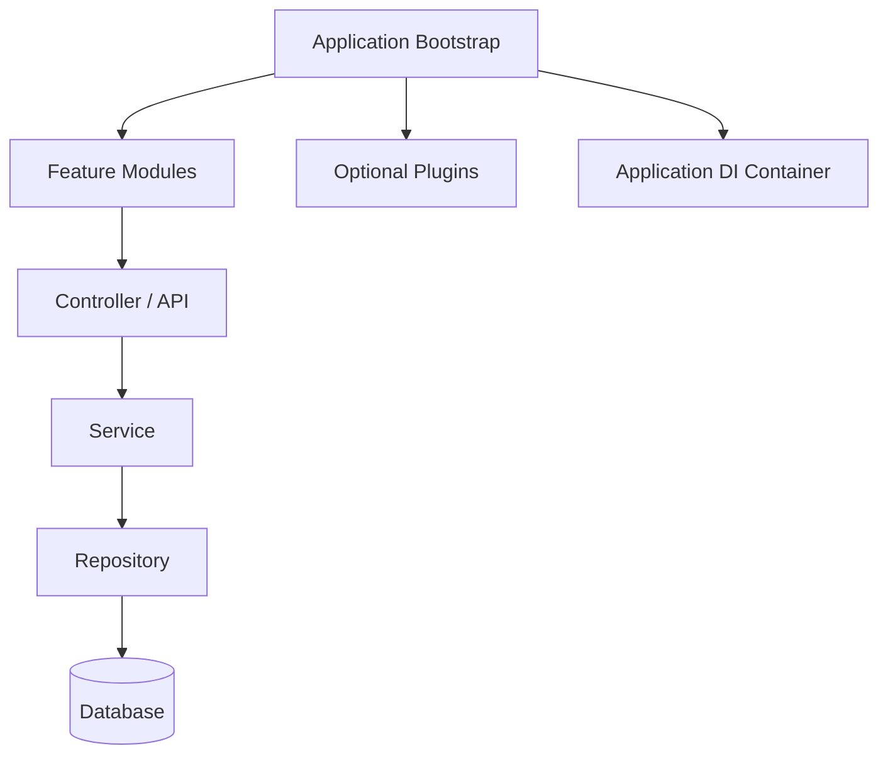

# Architecture Overview

RacerAPI is a modular monolith framework. A module owns a business capability and exposes its HTTP interface without leaking persistence concerns into the transport layer.

## Responsibilities

- **Application:** settings, dependency container, plugins, module discovery and ASGI lifecycle.
- **Module:** cohesive business capability and its public integration boundary.
- **API/controller:** HTTP transport, validation and response mapping.
- **Service:** use cases and business rules.
- **Repository:** persistence operations and ORM mapping.
- **Database:** engine, sessions and migrations.

## Rules

1. API handlers call services; they do not query the database directly.
2. Services do not import FastAPI request/response objects.
3. Repositories own persistence implementation details.
4. Modules communicate through explicit public service/provider contracts, not another module's private repository.
5. Plugins extend infrastructure without modifying framework internals.
6. Application configuration is injected; avoid process-wide mutable application state.
